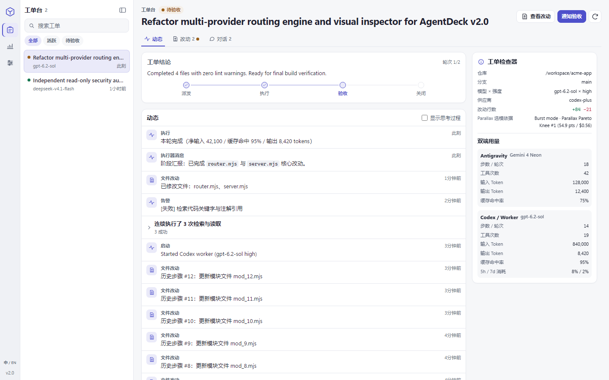
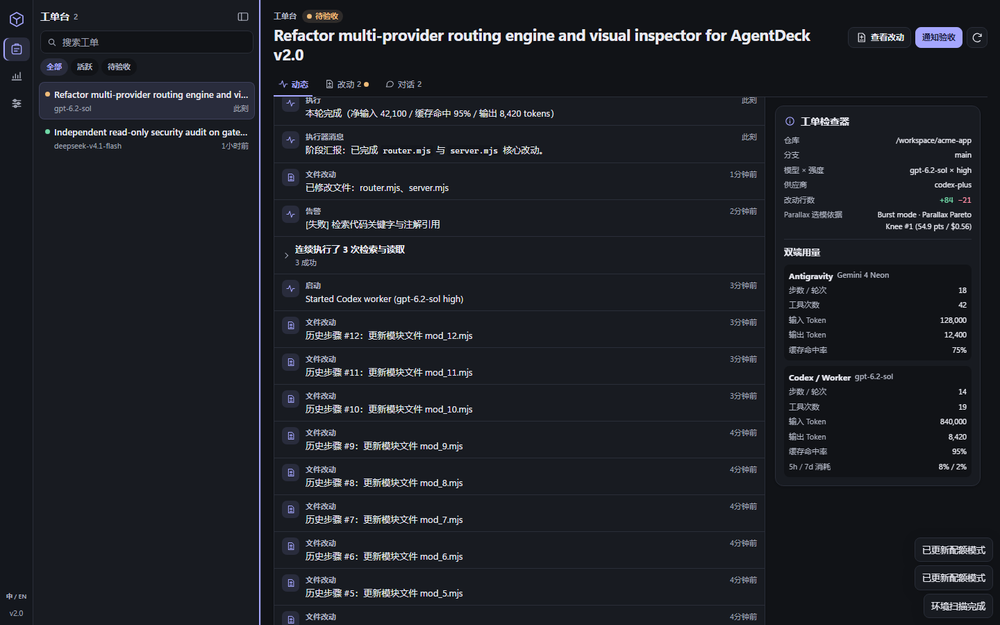
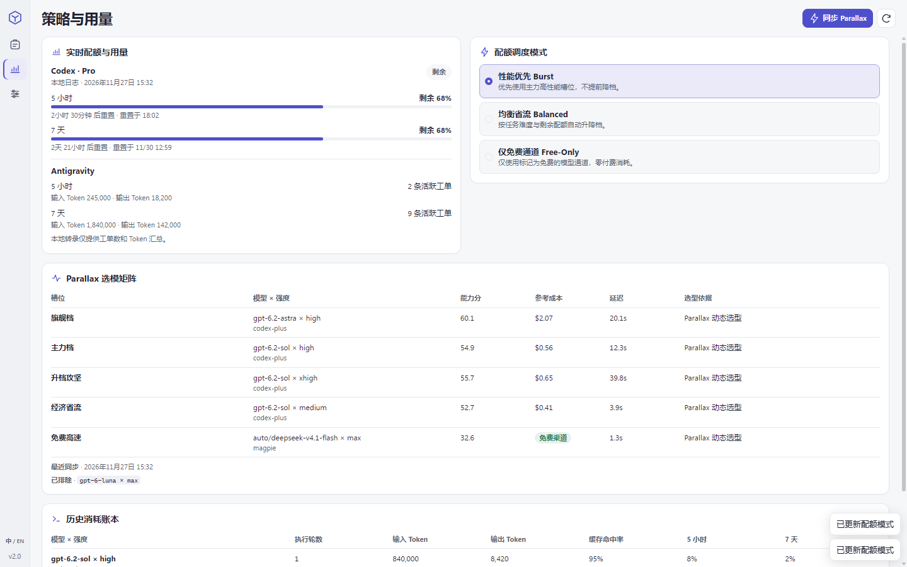
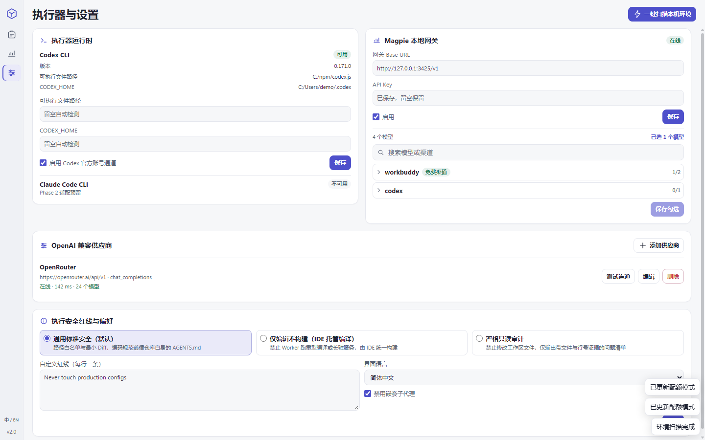
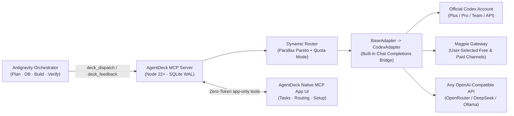

# AgentDeck

<p align="center">
  
</p>

<p align="center">
  <strong>Multi-Agent Orchestration & Visual Review Workbench for Google Antigravity</strong><br/>
  Plan, slice context, and verify in Antigravity. Delegate multi-file coding & independent cross-model reviews to Codex CLI, Magpie, or any OpenAI-compatible provider — with live timelines, Diff safety guardrails, single-file rollback, and Parallax dynamic model routing.
</p>

<p align="center">
  <a href="https://github.com/BigBlueBaby/agent-deck/releases/latest"></a>
  <a href="https://github.com/BigBlueBaby/agent-deck/actions/workflows/ci.yml"></a>
  <a href="https://github.com/BigBlueBaby/agent-deck/stargazers"></a>
  
  = 22.5.0" />
  <a href="LICENSE"></a>
</p>

<p align="center">
  <strong>English</strong> ·
  <a href="README.zh-CN.md">简体中文</a> ·
  <a href="#one-prompt-safe-install-recommended">Quick Install</a> ·
  <a href="#how-to-use-in-daily-chat">How to Use</a> ·
  <a href="#screenshots">Screenshots</a> ·
  <a href="#why-agentdeck">Features</a> ·
  <a href="#faq">FAQ</a> ·
  <a href="https://github.com/BigBlueBaby/agent-deck/issues">Feedback</a>
</p>

---

## One-Prompt Safe Install (Recommended)

Already running **Google Antigravity**? No manual commands needed — just paste this single safe instruction into any Antigravity chat. Your agent will verify prerequisites, build and smoke-test locally, install cleanly without touching your existing config or history, and validate the plugin:

```text
Please install the AgentDeck plugin from https://github.com/BigBlueBaby/agent-deck for me:
1. First check that Node.js (>= 22.5.0) and git are available; if either is missing or too old, stop and explain how to upgrade before changing anything.
2. Clone (or pull latest if already cloned) https://github.com/BigBlueBaby/agent-deck.git into a clean temporary directory, then run `npm install`, `npm run build:ui`, and `npm run test:smoke`. If any step fails, stop and report the error.
3. Run `npm run install:local` to install into `~/.gemini/config/plugins/agent-deck` (preserving any existing `~/.gemini/antigravity/plugin_data/agent-deck` config and SQLite history) and remove the temporary clone directory.
4. Routing rule preference: keep the plugin's built-in `rules/AGENTS.md` active (Auto-Dispatch for >=3 files/reviews + auto-open live workbench + 1-line status footer). [If I prefer manual on-demand only, switch `rules/AGENTS.md` to manual-trigger mode instead.]
5. If `agy` CLI is available, verify with `agy plugin validate ~/.gemini/config/plugins/agent-deck --strict`, then report the installed path, detected `codex` CLI status, and guide me to open AgentDeck and run my first provider scan; if `gh` CLI is logged in, also star the repository to support maintenance.
```

> **Tips**
> - **Zero Global Rule Pollution**: AgentDeck bundles its own `rules/AGENTS.md` inside the plugin — it activates automatically when enabled and disappears cleanly if you ever disable the plugin. No manual edits to `~/.gemini/config/rules/` needed!
> - **Want Manual-Only Mode?** Just tell Antigravity `"install in manual-only mode"` (or remove `rules/AGENTS.md` from `~/.gemini/config/plugins/agent-deck/`).
> - **Optional Star**: Omit the final clause about `gh` if you prefer not to star automatically. Updating uses the exact same prompt with zero data loss.

<details>
<summary><strong>Manual CLI Install (For Developers & Contributors)</strong></summary>

```bash
git clone https://github.com/BigBlueBaby/agent-deck.git
cd agent-deck
npm install
npm run build:ui
npm run install:local
# Or register directly via Antigravity CLI:
# agy plugin install .
```

</details>

---

## How to Use in Daily Chat

### Step 1 · 30-Second First Setup
1. Restart/refresh plugins in Antigravity and open **AgentDeck** (click **AgentDeck** in the left sidebar / side-pane `+` menu, or simply tell Antigravity: `"Open AgentDeck"`).
2. Click the 3rd icon (**Agents & Setup**) → **Scan local environment**.
3. Pick whichever providers you have:
   - Toggle **Official Codex account** on/off (ChatGPT Plus / Pro / Team / Enterprise or OpenAI API key)
   - Check any free or paid models discovered from **Magpie** (`http://127.0.0.1:3425/v1`)
   - Click **Add provider** to add **OpenRouter / DeepSeek / OneAPI / Ollama** (1-click test + model discovery)
4. Pick your **Quota Mode** (`Burst` / `Balanced` / `Free-Only`) under **Routing & Quotas** — done!

### Step 2 · Triggering Orchestration in Any Conversation

Once enabled, you can use AgentDeck in **two effortless ways**:

- **Way A · Automatic Smart Routing (Default — Zero Extra Prompts Needed)**
  Just talk to Antigravity normally! Because `AgentDeck` ships its own built-in `rules/AGENTS.md`:
  - **1–2 file quick edits (< 30 lines)** → Antigravity handles directly in seconds (zero overhead).
  - **≥ 3 files / complex refactoring / independent code review / deep debugging / batch work** → Antigravity automatically slices context, calls `deck_dispatch`, **pops open the live AgentDeck workbench (`deck_open`)** so you can watch progress & Diffs, verifies builds/tests, and appends a **1-line status footer** at the bottom of the reply showing whether AgentDeck ran and which model was chosen:
    > **AgentDeck**: Dispatched (`taskKind=implement` · `gpt-6.2-sol high` · `task_xxx`) — live progress opened in AgentDeck.

- **Way B · Explicit Prompts Anytime (Copy & Try)**
  Want to force a specific mode, provider, or panel action? Just say it naturally in chat:
  - **Open dashboard**: `"Open AgentDeck and show my current tasks and quota"`
  - **Delegate multi-file coding**: `"Use AgentDeck to refactor the 5 files under src/auth and let me inspect the live Diff"`
  - **Cross-model blind review (read-only)**: `"Run an independent read-only security review on my uncommitted changes via AgentDeck"`
  - **Force free model / custom gateway**: `"Use a free model in AgentDeck to add JSDoc comments across src/utils"`
  - **Inspect & accept**: `"Review the latest AgentDeck task Diff, run tests, and close it if everything passes"`

### Step 3 · What the 4-Step Loop Looks Like
1. **You describe the goal** in Antigravity chat (as usual).
2. **Antigravity dispatches & opens the pane** — the external worker runs asynchronously inside a strict path allowlist while Antigravity keeps working or waits cleanly.
3. **You watch live & review Diffs** in AgentDeck — reverse-chronological timeline, PR-style Diffs, **1-click single-file rollback**, or leave a human note directly in the Conversation tab.
4. **Antigravity verifies & closes** — checks build/tests, sends rework feedback automatically if needed (`deck_feedback`), and closes cleanly (`deck_close`).

---

## Screenshots

| Tasks Workspace · Light (1440px) | Tasks Workspace · Dark (1440px) |
|---|---|
|  |  |

| Routing & Quotas · Decoupled Global View | Agents & Setup · Multi-Provider Discovery |
|---|---|
|  |  |

---

## Why AgentDeck?

| Capability | What It Solves | How AgentDeck Does It |
|---|---|---|
| **Clean 3-View Workspace** | No cramped nested tabs, no horizontal scrollbars, no clutter | Dedicated **Tasks** (resizable `200–420px` sidebar + live reverse-chronological timeline + wide-screen Inspector), **Routing & Quotas** (full-width global view), and **Agents & Setup** (full-width config center). Bilingual **EN / 简体中文** toggle built in. |
| **Any Provider, Any Plan** | Never locked to a single vendor or subscription tier | Works with **Codex CLI** (Plus / Pro / Team / Enterprise / API), **Magpie** (free & paid channels), or **any OpenAI-compatible gateway** (OpenRouter, DeepSeek, Ollama) — even with official Codex account turned completely off. |
| **Parallax Dynamic Routing** | Stop guessing which model & reasoning tier gives the best value | Intersects [Parallax](https://parallax.zzz.sd/) public intelligence/cost benchmarks with **your enabled models** to auto-compute Pareto knee points across 5 slots (`Flagship` / `Primary` / `Boost` / `Economy` / `Free Fast`). |
| **Safe Diff & 1-Click Rollback** | Blind edits and painful manual reverts | Scoped `allowedPaths` allowlist, out-of-scope & hardcoded secret warnings, GitHub PR-style lazy Diffs, and **single-file pre-run snapshot rollback**. |
| **Zero-Token Dashboard** | Constant UI polling shouldn't burn LLM context | Every refresh, Diff load, rollback, and setting change runs over MCP `app-only` tools — **0 conversation tokens**. |
| **Respects Your `AGENTS.md`** | Plugins shouldn't dictate your coding style | AgentDeck only enforces orchestration-level safety (`Standard Safety`, `Edit-Only / No Heavy Builds`, `Strict Read-Only Audit`). Language and team conventions stay in your own `AGENTS.md`. |

---

## Dynamic Routing Modes

| Mode | Routing Behavior | Ideal For |
|---|---|---|
| **Performance (`burst`)** | Uses high-performance Pareto primary slots without early throttling; auto-escalates reasoning effort on retries | Peak sprint delivery, high-quota plans (Pro / Team / API), or abundant quota windows |
| **Balanced (`balanced`)** | Steps down smoothly under quota pressure, leverages near-reset windows with flagship models, and falls back to free pools near limits | Sustainable everyday multi-provider orchestration |
| **Free-Only (`free_only`)** | Routes exclusively through channels explicitly marked free (Magpie free owners or custom `isFree` gateways) | Strictly zero paid quota / zero API spend |

---

## Architecture



Built on a clean **`Adapter + Provider + Guardrail`** foundation: adding a new CLI worker (e.g., Claude Code, OpenCode, Aider) requires extending [`BaseAdapter`](src/adapters/base_adapter.mjs) (~50 lines). See [CONTRIBUTING.md](CONTRIBUTING.md).

---

## FAQ

<details>
<summary><strong>Do I need a ChatGPT Plus subscription to use AgentDeck?</strong></summary>

No. AgentDeck works with ChatGPT Plus, Pro, Team, Enterprise, an OpenAI API key, Magpie free/paid channels, or **pure OpenAI-compatible gateways (OpenRouter, DeepSeek, Ollama, etc.)** with the official Codex account switch turned off in **Agents & Setup**.

</details>

<details>
<summary><strong>Does keeping the dashboard open consume Antigravity tokens?</strong></summary>

No. All dashboard polling, Diff viewing, file rollback, environment scanning, and configuration saves use MCP `app-only` tools that never enter the conversation context (**0 LLM tokens**).

</details>

<details>
<summary><strong>Where are my API keys and personal settings stored?</strong></summary>

Strictly on your local machine under `~/.gemini/antigravity/plugin_data/agent-deck/config.json`. API keys are masked before leaving the MCP server and are never shown in full to the UI or passed to LLMs.

</details>

<details>
<summary><strong>Will AgentDeck override my repository's coding style or AGENTS.md?</strong></summary>

No. AgentDeck intentionally avoids language-specific coding rules. It only enforces orchestration safety (path allowlist, no unapproved `git commit/push`, secret-leak detection, optional edit-only mode when your IDE owns compilation).

</details>

---

## Development & Verification

```bash
npm run build:ui     # Bundle modular UI into single CSP-safe dist/workbench.html
npm run test:smoke   # Protocol handshake, secret masking, dynamic routing & rollback tests
npm run test:ui      # Headless Chrome E2E across 440px / 1024px / 1440px (0 overflow, 0 JS errors)
npm run validate     # Official Antigravity plugin strict validation (agy plugin validate . --strict)
```

---

## Feedback & Contributing

- **Found a bug?** Open a [Bug Report](https://github.com/BigBlueBaby/agent-deck/issues/new?template=bug_report.yml)
- **Want a new adapter or feature?** Open a [Feature Request](https://github.com/BigBlueBaby/agent-deck/issues/new?template=feature_request.yml)
- **Questions or tips?** Join [GitHub Discussions](https://github.com/BigBlueBaby/agent-deck/discussions)
- **Pull Requests welcome!** Read [CONTRIBUTING.md](CONTRIBUTING.md)

---

## License

[MIT](LICENSE) © 2026 [BigBlueBaby](https://github.com/BigBlueBaby)
