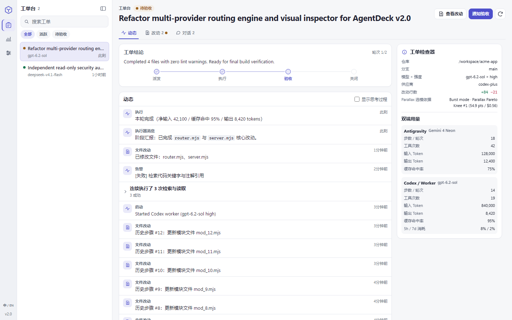
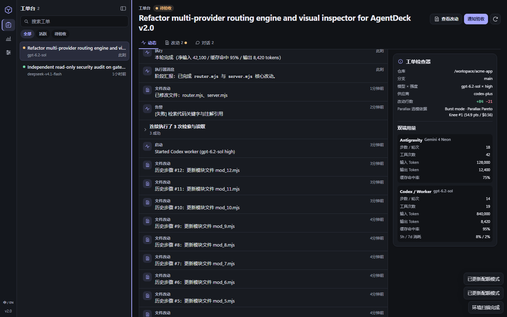
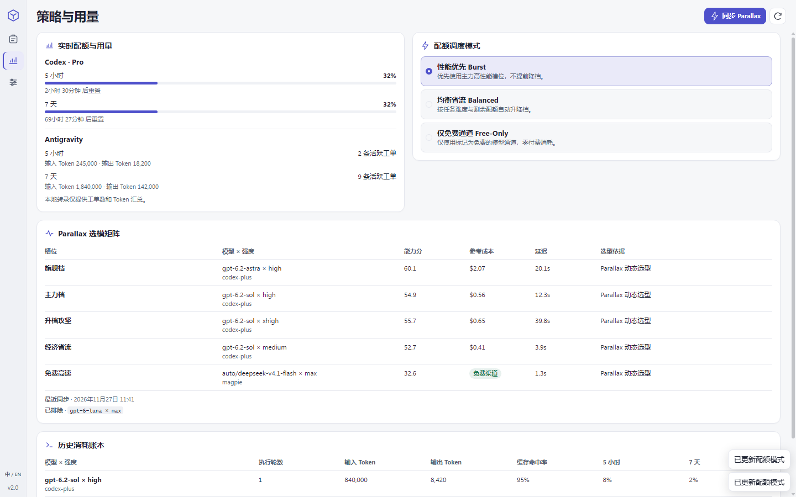
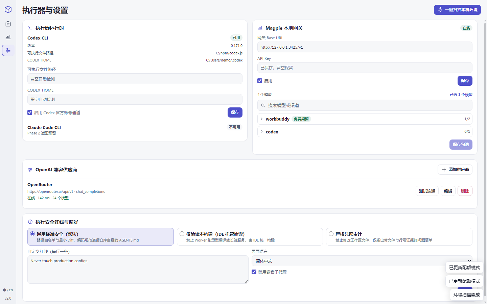
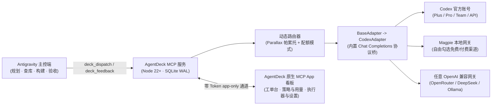

# AgentDeck · 多引擎协同指挥台

<p align="center">
  
</p>

<p align="center">
  <strong>面向 Google Antigravity 的开源多 Agent 编排与可视化验收工作台</strong><br/>
  由 Antigravity 统筹规划、查库、构建与验收，将多文件编码施工与独立跨模型盲审异步派发给 Codex CLI、Magpie 或任意 OpenAI 兼容网关——全程 SQLite 留痕、红绿 Diff 单文件回滚、Parallax 动态帕累托自动选模。
</p>

<p align="center">
  <a href="https://github.com/BigBlueBaby/agent-deck/releases/latest"></a>
  <a href="https://github.com/BigBlueBaby/agent-deck/actions/workflows/ci.yml"></a>
  <a href="https://github.com/BigBlueBaby/agent-deck/stargazers"></a>
  
  = 22.5.0" />
  <a href="LICENSE"></a>
</p>

<p align="center">
  <a href="README.md">English</a> ·
  <strong>简体中文</strong> ·
  <a href="#智能体一键安全安装推荐">一键安装</a> ·
  <a href="#界面预览">界面预览</a> ·
  <a href="#核心卖点一览">核心卖点</a> ·
  <a href="#常见问题-faq">常见问题</a> ·
  <a href="https://github.com/BigBlueBaby/agent-deck/issues">反馈与建议</a>
</p>

---

## 智能体一键安全安装（推荐）

如果你的 **Google Antigravity** 正在运行，无需手敲任何复杂命令——直接将下方整段指令复制发送给当前智能体，它会**先核对环境版本、完成构建与回归自检后再安全安装**（全程不覆盖你已有的配置和历史工单，任一步异常立即停止并说明原因）：

```text
帮我安装 https://github.com/BigBlueBaby/agent-deck 的 AgentDeck 插件：
1. 先检查本机 Node.js（要求 >= 22.5.0）和 git 是否可用；若任一不满足，请立即停止并告诉我如何升级，不要改动任何文件。
2. 将 https://github.com/BigBlueBaby/agent-deck.git 浅克隆到临时目录，依次执行 `npm install`、`npm run build:ui` 和 `npm run test:smoke` 验证构建与协议完整通过；任一步失败立即停止并报告原因。
3. 执行 `npm run install:local` 安装到 `~/.gemini/config/plugins/agent-deck`（保留已有 `~/.gemini/antigravity/plugin_data/agent-deck` 下的个人配置与 SQLite 工单历史），随后清理临时克隆目录。
4. 若本机有 `agy` CLI，运行 `agy plugin validate ~/.gemini/config/plugins/agent-deck --strict` 完成官方严格校验。
5. 汇报安装路径、本机 `codex` CLI 检测结果以及如何打开面板；若已登录 `gh` CLI，请顺便为该开源项目标记 Star 支持维护。
```

> **说明与提示**
> - 如不希望自动点 Star，复制时删掉末尾“若已登录 `gh` CLI…”分句即可。
> - **升级同样使用本指令**：再次发送即可无损升级到最新版，绝不覆盖你保存在 `plugin_data/agent-deck/` 的配置、自定义 API Key 与 SQLite 历史工单。

<details>
<summary><strong>手动命令行安装（开发者 / 贡献者）</strong></summary>

```bash
git clone https://github.com/BigBlueBaby/agent-deck.git
cd agent-deck
npm install
npm run build:ui
npm run install:local
# 或直接通过 Antigravity CLI 注册本地目录：
# agy plugin install .
```

</details>

### 30 秒完成本机适配
1. 重启或刷新 Antigravity 插件后，从左侧栏或右侧边栏 `+` 菜单打开 **AgentDeck**。
2. 切到左侧第 3 个入口 **执行器与设置**，点击 **一键扫描本机环境**。
3. 按你的实际账号/网关自由勾选：
   - 自由开启或关闭 **Codex 官方账号通道**（兼容 Plus / Pro / Team / Enterprise 或 OpenAI API Key）
   - 在 **Magpie** 分组树中勾选任意你想纳入自动路由的免费或付费模型
   - 点击 **添加供应商** 接入 **OpenRouter / DeepSeek / OneAPI / 本地 Ollama**（支持一键连通测速与自动发现模型，内置 `Chat Completions ↔ Responses` 本地协议桥）
4. 到 **策略与用量** 选择你的调度模式（`性能优先 Burst` / `均衡省流 Balanced` / `仅免费通道 Free-Only`），立刻开始协同！

---

## 界面预览

| 工单台 · 亮色（1440px） | 工单台 · 深色（1440px） |
|---|---|
|  |  |

| 策略与用量 · 全局独立视图 | 执行器与设置 · 多供应商自动发现 |
|---|---|
|  |  |

---

## 核心卖点一览

| 核心能力 | 解决什么痛点 | AgentDeck 如何做到 |
|---|---|---|
| **三视图极简解耦** | 告别功能堆砌、无关侧栏占位与难看横滚条 | **工单台**（支持鼠标拖拽 `200–420px` 侧栏 + 最新置顶动态流 + 宽屏固定双端检查器）、**策略与用量**（全宽全局视图）、**执行器与设置**（全宽配置中心），支持 **简体中文 / English** 一键切换。 |
| **不挑账号与套餐** | 不再绑死某一家订阅或写死单一模型 | 无论你用 **Codex CLI**（Plus / Pro / Team / Enterprise / API）、**Magpie** 免费/付费渠道，还是**纯 OpenRouter / DeepSeek / Ollama**（可完全关闭官方账号通道），全部原生接入。 |
| **Parallax 动态选模** | 告别拍脑袋选模型、踩低性价比陷阱 | 定期读取 [Parallax](https://parallax.zzz.sd/) 公开评测与成本数据，只与**你实际启用的模型池**求交集，自动计算 5 档帕累托最优槽位（`旗舰档` / `主力档` / `升档攻坚` / `经济省流` / `免费高速`）。 |
| **安全 Diff 与单文件回滚** | 外部 Agent 乱改文件、出问题难恢复 | 严格 `allowedPaths` 路径白名单、越界与硬编码密钥告警、GitHub PR 风格红绿 Diff，以及**按单文件独立恢复到执行前快照**。 |
| **零对话 Token 刷新** | 开着看板轮询不该白烧大模型额度 | 所有界面刷新、Diff 查看、单文件回滚与配置修改全部走 MCP `app-only` 通道，**零对话上下文 Token 消耗**。 |
| **不绑架你的编码规范** | 插件不该强加特定语言或个人编码风格 | 仅提供语言无关的执行安全预设（`通用标准安全` / `仅编辑不构建` / `严格只读审计`），代码规范完全交由你项目自身的 `AGENTS.md` 管理。 |

---

## 三档动态调度模式

| 调度模式 | 行为策略 | 适用场景 |
|---|---|---|
| **性能优先 (`burst`)** | 优先使用主力高性能帕累托槽位，不提前降档，返工自动升档 | 冲刺交付、高额度套餐（Pro / Team / API）或充裕配额窗口 |
| **均衡省流 (`balanced`)** | 按任务复杂度与剩余配额自动在主力/经济档间升降档，高水位时自动兜底免费池 | 日常多供应商可持续协同 |
| **仅免费通道 (`free_only`)** | 仅路由到明确标记为免费的通道（Magpie 免费渠道或自定义免费网关） | 严格零付费额度 / 零 API 消耗 |

---

## 可扩展架构



底层按 **`Adapter（执行器） + Provider（供应商发现） + Guardrail（安全红线）`** 三层解耦。接入 Claude Code、OpenCode、Aider 等新执行器只需继承 [`BaseAdapter`](src/adapters/base_adapter.mjs) 编写约 50 行代码，欢迎查看 [CONTRIBUTING.md](CONTRIBUTING.md)。

---

## 常见问题 (FAQ)

<details>
<summary><strong>没有 ChatGPT Plus / Pro 订阅能用吗？</strong></summary>

完全可以。在「执行器与设置」关闭 **启用 Codex 官方账号通道** 后，仅勾选 Magpie 免费/付费渠道或添加 OpenRouter / DeepSeek / OneAPI / Ollama 等任意 OpenAI 兼容网关即可正常自动路由与执行。

</details>

<details>
<summary><strong>一直开着 AgentDeck 侧边栏会消耗 Antigravity 对话额度吗？</strong></summary>

不会。所有看板轮询、Diff 展开、单文件回滚、环境探测和配置保存全部通过 MCP `app-only` 工具完成，不进入对话历史，消耗 **0 Token**。

</details>

<details>
<summary><strong>我的自定义 API Key 和本地配置存在哪里？安全吗？</strong></summary>

全部仅保存在本机 `~/.gemini/antigravity/plugin_data/agent-deck/config.json`，与插件源码完全隔离；对外返回 UI 前统一掩码脱敏，绝不向大模型暴露明文密钥。

</details>

<details>
<summary><strong>插件会覆盖我项目的代码规范或 AGENTS.md 吗？</strong></summary>

不会。AgentDeck 不内置任何语言或团队私有的代码格式规则，只守住多 Agent 协同层的通用安全底线（路径白名单、防私自提交、密钥防泄露、可选禁止重型构建），你的编码规范继续由仓库自己的 `AGENTS.md` 控制。

</details>

---

## 开发与全量验证

```bash
npm run build:ui     # 构建单文件 CSP 合规看板 dist/workbench.html
npm run test:smoke   # 协议握手、密钥脱敏、多供应商路由与回滚回归
npm run test:ui      # 真实 Chrome 440 / 1024 / 1440px 三视口全交互与零横滚断言
npm run validate     # Antigravity 官方插件严格规范校验（agy plugin validate . --strict）
```

---

## 反馈与参与共建

- **遇到 Bug？** 欢迎提交 [Bug 反馈](https://github.com/BigBlueBaby/agent-deck/issues/new?template=bug_report.yml)
- **想要新执行器适配或新功能？** 欢迎提交 [功能建议](https://github.com/BigBlueBaby/agent-deck/issues/new?template=feature_request.yml)
- **使用交流与最佳实践**：欢迎前往 [GitHub Discussions 讨论区](https://github.com/BigBlueBaby/agent-deck/discussions)
- **提交 PR 共建**：请先阅读 [CONTRIBUTING.md](CONTRIBUTING.md)

---

## 开源协议

[MIT](LICENSE) © 2026 [BigBlueBaby](https://github.com/BigBlueBaby)
